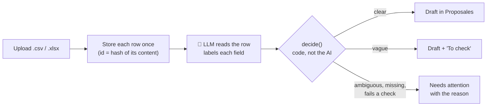

# Enquiry desk: proposals that create themselves

Upload a spreadsheet of hotel enquiries. An LLM reads every row, and a draft proposal is waiting in [Proposales](https://proposales.com) for each one it can safely draft, seconds later.

**Live app:** <https://proposales.ivona.se> · **Repo:** <https://github.com/iwarra/proposales>

> **Vague is fine. Ambiguous is not.**
>
> Clear → draft. Vague → draft, marked for you to confirm. Could mean two things → we tell you why, and you handle it.

## Contents

- [The salesperson's story](#the-salespersons-story)
- [Try it in two minutes](#try-it-in-two-minutes)
- [How it works](#how-it-works)
- [When the AI is unsure or wrong](#when-the-ai-is-unsure-or-wrong)
- [What happens when things go wrong](#what-happens-when-things-go-wrong)
- [Two requests changing the same thing at the same time](#two-requests-changing-the-same-thing-at-the-same-time)
- [Running it locally](#running-it-locally)
- [Testing](#testing)
- [Project structure](#project-structure)
- [Limitations and next version](#limitations-and-next-version)

## The salesperson's story

Monday morning: a hotel salesperson has a sheet of new enquiries from web forms and emails. The columns are messy ("Pax", "Firma", "Antal gäster"), and the details are written in free text. Normally they would copy each one into a proposal by hand.

Instead, they upload the sheet:

- **"Kick-off 12–13 March 2027 for 40 people"** is clear. A draft appears in Proposales with the dates, the guests, the client and the original enquiry.
- **"Offsite mid May 2027, about 30–40 people"** is vague but has one meaning. The draft is created anyway, with "mid May" and "30–40" shown as the client wrote them and a **To check** list at the top.
- **"Board dinner on 2027.12.03 for 12"** could be 3 December or 12 March. No draft is created. The row is listed under **Needs attention**, with the reason.

Nothing is guessed, and nothing is created twice.

## Try it in two minutes

1. Open the [live app](https://proposales.ivona.se).
2. Click **Load example file** in the banner at the top and upload it, or upload [`public/example-enquiries.csv`](public/example-enquiries.csv) yourself.
3. Watch the three rows go from **Received** to **Reading** and end up as **Drafted**, **Drafted** (to confirm) and **Blocked**. The list refreshes by itself.
4. Open Proposales: two new drafts are waiting.
5. Upload the same file again: nothing new is created.

[`public/blocked-enquiries.csv`](public/blocked-enquiries.csv) has 11 rows, one for each reason a row is blocked. It creates no drafts, and each company name says which case the row tests.

## How it works



1. **Upload.** A `.csv` or `.xlsx` with one enquiry per row, up to 1 MB and 500 rows. Each row is stored once, under a hash of its content.
2. **The AI reads each row** after the response is sent, 4 rows at a time. One LLM call per row, with structured output (a Zod schema). It finds the client, event, dates, guests, rooms, meeting space and catering, whatever the columns are called.
3. **The AI labels** the dates, the guest count and the rooms count as `exact`, `approximate`, `ambiguous` or `missing`. It also says whether the row is an event enquiry at all.
4. **Code decides.** [`decide()`](src/lib/decide/decide.ts) applies one fixed policy table (below).
5. **The draft is created in Proposales** with a title, the client as recipient, the details, a **To check** list for approximate values, and the original enquiry quoted. Every draft carries `data.enquiry_id`, which is what makes duplicates detectable.
6. **Blocked rows are listed under "Needs attention"** with every reason.

**Stack:** Next.js, the Vercel AI SDK with Claude, Upstash Redis, Tailwind, Vitest.

## When the AI is unsure or wrong

The LLM never decides whether a draft is created. It only reads and labels. A pure function then applies this table:

| Field  | exact                      | approximate   | ambiguous | missing     |
| ------ | -------------------------- | ------------- | --------- | ----------- |
| dates  | ✅ if it passes the checks | ✅ to confirm | ❌        | ❌          |
| guests | ✅ if it passes the checks | ✅ to confirm | ❌        | ❌          |
| rooms  | ✅ if it passes the checks | ✅ to confirm | ❌        | ✅ optional |

- **Unsure** (the model labels a value `approximate` or `ambiguous`): approximate values become a draft with a To check list, and ambiguous values block the row.
- **Wrong** (the model says `exact` but the value doesn't hold up): code checks every exact value. A date that doesn't exist (`2027-02-30`), a start date in the past, an end before the start, fewer than 1 guest, negative rooms or more rooms than guests → ❌.
- **Not an enquiry** (a newsletter, a complaint) → ❌.
- **An answer that doesn't fit the schema** → the row is marked **Failed** and can be retried.

**Why vague values still get a draft:** the point is for the salesperson to do less work. A draft with "mid May, to confirm" is almost done. A blocked row means writing the whole proposal by hand. Ambiguous values are blocked because picking the wrong meaning could lead to a wrong booking.

The details are in [`mvp-docs/ai-reading.md`](mvp-docs/ai-reading.md) and [`mvp-docs/decide.md`](mvp-docs/decide.md).

## What happens when things go wrong

Any step can fail, run twice, or run at the same time as another without creating duplicates. Every failure is saved on the row with its reason and shown to the salesperson, never thrown away.

| What goes wrong                                                                                | What the salesperson sees                                        | What happens next                                                              |
| ---------------------------------------------------------------------------------------------- | ---------------------------------------------------------------- | ------------------------------------------------------------------------------ |
| The file isn't a `.csv` or `.xlsx`, can't be read, is empty, is over 1 MB or has over 500 rows | A message they can act on, e.g. _"Upload a .csv or .xlsx file."_ | Nothing is stored                                                              |
| A row has only contact details                                                                 | Listed as skipped, with the reason                               | The row isn't stored                                                           |
| The AI times out, the proxy is down, or the answer doesn't fit the schema                      | **Failed**: "The AI couldn't read this enquiry: …"               | **Retry** sends the row to the AI again                                        |
| The AI's answer is unclear or wrong                                                            | **Blocked**, with every reason                                   | The salesperson handles it, or fixes the row in the sheet and uploads it again |
| Proposales is down or rejects the request                                                      | **Failed**: "Couldn't create the draft in Proposales: …"         | **Retry** goes straight to creating the draft. The AI isn't called again       |
| Proposales rejects the token or company id (401/403)                                           | **Failed**, saying it's a setup problem and naming the variables | Fix the environment, then Retry                                                |
| A worker stops partway through (crash, function timeout)                                       | The row stays Received or Ready                                  | After 60 s a **Retry** button appears, or **Create draft**                     |
| A required environment variable is missing or malformed                                        | A message naming the variable                                    | Nothing is called                                                              |

**Every Retry is safe to click any number of times.**

### Running twice without duplicates

- **The same file uploaded twice:** each row's id is a hash of its content, and rows are saved with `SET NX`. A row seen before is counted as a duplicate, and nothing new is stored or processed.
- **A row the AI already read** isn't sent to the AI again, so retries and re-uploads cost nothing.
- **A row that already has a draft** is never drafted again (see [below](#two-requests-changing-the-same-thing-at-the-same-time)).

## Two requests changing the same thing at the same time

**Invariant:** one enquiry gets at most one proposal in Proposales.

**The race:** a double-click, two tabs, a Retry racing the background job, or parallel calls to `POST /api/enquiries/{id}/draft`. Vercel functions don't share memory, so the coordination happens in Redis.

**Approach:** every path goes through [`ensureDraft()`](src/lib/drafts/ensure-draft.ts): check, lock, check again, reconcile, then create.

```text
draft:{id} exists?               → return it                (fast path, no lock)
SET draft-lock:{id} NX EX 60     → lost the lock? "in progress"
draft:{id} exists?               → return it                (someone finished while we raced)
search Proposales by enquiry_id  → found? save its id       (recovers a crash after create)
create, then SET draft:{id} NX                              (write-once)
release the lock if our token still holds it                (atomic compare-and-delete)
```

Design notes:

- **The lock alone isn't enough.** If a worker crashes after Proposales creates the draft but before its id is saved, the next attempt would create a second one. Every draft carries `data.enquiry_id`, so Proposales itself is the source of truth for recovery. This is also why a create that timed out is never retried blindly.
- **Each lock's expiry covers the holder's worst case.** 60 s covers a search plus a create (each at most 3 × 8 s). A separate `process-lock:{id}` (5 min) wraps the whole AI read and draft, so the LLM is never paid twice for the same row. Expiry is how a crashed worker's lock gets freed.
- **A worker can only release its own lock.** Each lock stores a random token. If a slow worker's lock expires and another worker takes it, the slow one's release does nothing, so it can't free a lock it no longer holds.
- **Losers don't block.** They return `in_progress` (409) right away, and the UI polls until the row is Drafted.

**Tested** in memory: five racing calls create one draft, a crash between create and save doesn't create a second, and a click racing the background job creates one ([ensure-draft.test.ts](src/lib/drafts/ensure-draft.test.ts), [process.test.ts](src/lib/processing/process.test.ts)).

### Statuses

Statuses are never stored, so they can't get out of sync. Each time a row is shown they're worked out from the keys, and the first rule that matches wins:

1. A draft id is saved → **Drafted**
2. A worker holds the row's lock → **Reading**
3. The AI hasn't read the row → **Received** (a Retry button appears after 60 s with no worker)
4. The last attempt saved an error → **Failed**
5. `decide()` blocks it → **Blocked**
6. Otherwise → **Ready** (a **Create draft** button)

Because `decide()` runs again each time, a Ready row whose exact start date has passed becomes Blocked. A Drafted row stays Drafted.

### API

`POST /api/enquiries/{id}/draft` creates the draft for one enquiry through the same `ensureDraft()`:

| Status | Meaning                                   |
| ------ | ----------------------------------------- |
| `201`  | Created                                   |
| `200`  | Already exists                            |
| `404`  | No such enquiry                           |
| `409`  | In progress, or the AI hasn't read it yet |
| `422`  | Blocked, with the reasons                 |
| `502`  | Proposales failed                         |

## Running it locally

**Requirements:** Node.js 20+, a [Proposales](https://proposales.com) account, an LLM endpoint, and an [Upstash Redis](https://upstash.com) database.

```bash
cp .env.example .env.local   # fill in the values below
npm install
npm run dev                  # http://localhost:3000
```

| Variable                                             | Required | Meaning                                                      |
| ---------------------------------------------------- | -------- | ------------------------------------------------------------ |
| `PROPOSALES_API_TOKEN`                               | Yes      | API key. In Proposales: Settings → Profile                   |
| `PROPOSALES_COMPANY_ID`                              | Yes      | The company drafts are created in (from `GET /v3/companies`) |
| `LLM_PROXY_URL`, `LLM_PROXY_KEY`                     | Yes      | Where the model is reached.                                  |
| `LLM_MODEL`                                          | No       | Defaults to `claude-sonnet-5-5`                              |
| `LLM_PROXY_FORMAT`                                   | No       | `anthropic` (default) or `openai`                            |
| `UPSTASH_REDIS_REST_URL`, `UPSTASH_REDIS_REST_TOKEN` | Yes      | Redis, over REST                                             |

The Redis database should belong to this app alone: the keys (`enquiries`, `enquiry:{id}`, `extraction:{id}`, `draft:{id}`, and the two locks) aren't namespaced.

## Testing

```bash
npm test        # unit tests, no network: a fake model, a fake Proposales and in-memory Redis
npm run lint
npm run build
```

## Project structure

```text
src/
  app/            the page, server actions, the draft route; wiring from the environment
  ui/             shared components: buttons, card, file input, status chip
  lib/
    enquiries/    parse the file, content ids, storage, statuses
    ai/           the schema, the prompt, the LLM call
    decide/       decide(): the policy table and code checks  ← pure
    proposales/   API client, reading → create-proposal body  ← body is pure
    drafts/       ensureDraft(): exactly one draft per enquiry
    processing/   one row end to end: lock → read → decide → draft
    kv/           the Redis operations, locks, and an in-memory fake
    env/          reads and checks the environment
mvp-docs/         the spec: the source of truth the code follows
public/           the two test sheets
```

The full spec, including the prompt rules, the draft layout and the build plan, is in [`mvp-docs/`](mvp-docs/README.md).

## Limitations and next version

- **Fixing a blocked row in the app.** A disabled "Fix & create draft" button, marked "Coming in V2", shows where it goes. Today the salesperson writes that proposal in Proposales, or fixes the row in the sheet and uploads it again (a changed row is a new enquiry). When it's built, each saved reading gets a version, and a save with an old version is rejected instead of overwriting someone else's fix.
- **Sign-in.** Every draft is created on the account behind `PROPOSALES_API_TOKEN`, and anyone who can reach the app can upload.
- **One source.** Enquiries arrive as a spreadsheet. An inbox or a web form would feed the same pipeline: everything after "store the row" stays the same.
