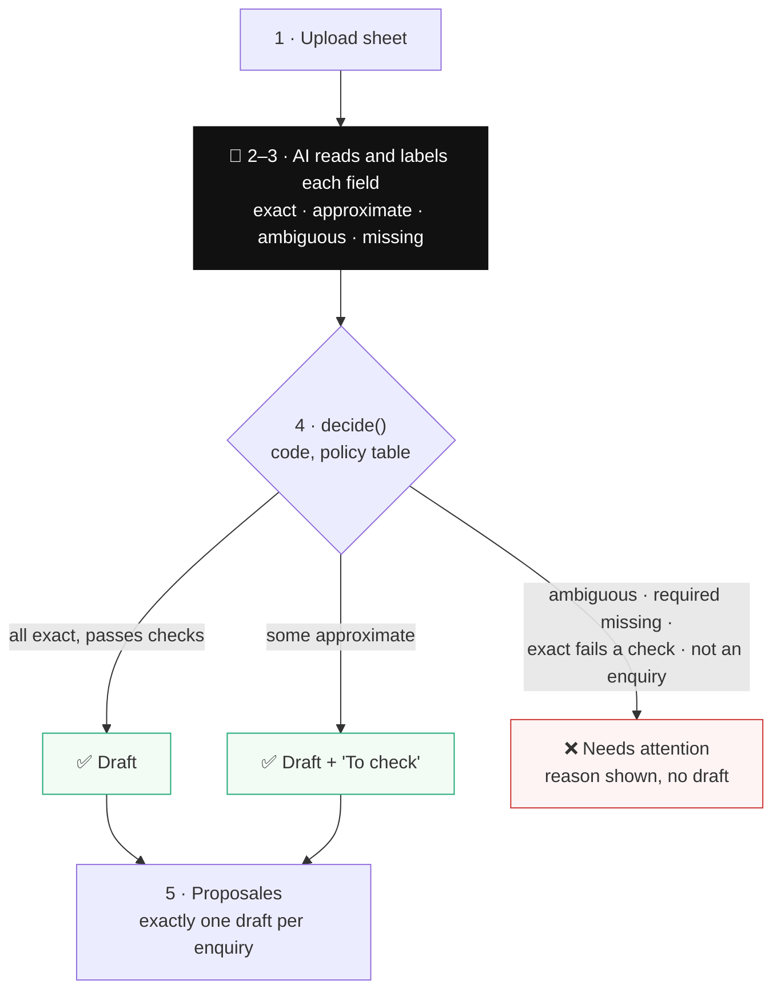

# Proposals that create themselves: MVP

> **Status: planned.** These docs describe the MVP: what it does and how to build it.

A hotel salesperson uploads a spreadsheet of enquiries. The AI reads every row, and a draft proposal appears in Proposales for each one it can safely draft.

## The rule

> **Vague is fine. Ambiguous is not.**

- **Vague** ("mid March", "30–40 people") has one meaning that just isn't precise. The draft is created, and the value is marked for the salesperson to confirm.
- **Ambiguous** ("2027.12.03", "Pax 60 but the text says 40") could mean two things. Picking one could lead to a wrong booking, so the row is blocked.

**Why vague values get a draft:** the case is about the salesperson doing less work. A draft with "mid March, to confirm" is almost done. A blocked row means writing the whole proposal by hand.

For the salesperson there are three outcomes:

> **Clear → draft. Vague → draft, marked for you to confirm. Could mean two things → we tell you why, and you handle it.**

## The flow

1. **Upload.** The salesperson uploads the sheet. Each row is one enquiry. Uploading the same file again adds nothing new.
2. **The AI reads each row.** It finds the client, event, dates, guests, rooms, meeting space and catering, whatever the columns are called.
3. **The AI labels the dates, the guest count and the rooms count:** exact, approximate, ambiguous or missing. It also says whether the row is an event enquiry at all.
4. **Code decides, not the AI.** `decide()` applies a fixed policy table: draft, draft with values to confirm, or blocked.
5. **The draft appears in Proposales.** Approximate values are shown as the client wrote them, with a "To check" list and the original enquiry quoted. Each enquiry gets only one draft.
6. **Blocked rows are listed under "Needs attention"** with the reason. A disabled "Fix & create draft — coming next" button shows what the next version adds.

## The docs

| Doc | What it covers |
|---|---|
| [case.md](case.md) | The case, how the MVP answers it, the definition of done, the presentation, a glossary |
| [user-story.md](user-story.md) | The user story and acceptance criteria for the MVP |
| [ai-reading.md](ai-reading.md) | Steps 2–3: the AI's output schema and prompt rules |
| [decide.md](decide.md) | Step 4: the policy table and the code checks |
| [draft.md](draft.md) | Step 5: what the draft in Proposales looks like |
| [needs-attention.md](needs-attention.md) | Step 6: blocked rows now, and the fix flow in the next version |
| [when-things-go-wrong.md](when-things-go-wrong.md) | Failures, retries, duplicates and concurrent requests |
| [integrations.md](integrations.md) | Proposales API, retry rules, LLM and Redis setup, environment |
| [plan.md](plan.md) | Stack, modules, parsing, storage, design, build order, testing, and what's left out |
